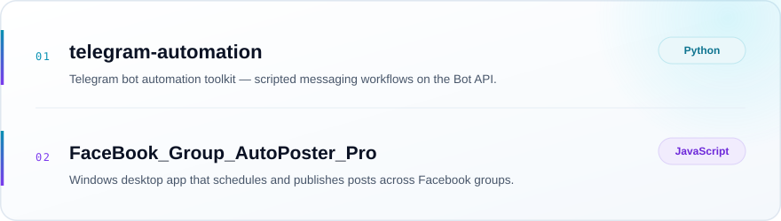

<!-- ══════════════════════════════════════════════════════════════════════
     Rasel Ahmed · @theraseldev
     Profile README — theme-aware hero, service cards, selected work
     ══════════════════════════════════════════════════════════════════════ -->

  <picture>
    <source media="(prefers-color-scheme: dark)" srcset="./assets/banner-dark.svg">
    <source media="(prefers-color-scheme: light)" srcset="./assets/banner-light.svg">
    
  </picture>

  

  
  
  

 

## 👤 About

I'm a **developer and tech entrepreneur** from Bangladesh. I build software that removes
repetitive work — Python automation, desktop tools, Telegram bots, and AI-assisted web utilities.

- 🔭 **Building** automation tools that take over the boring, repeatable parts of running an online business
- 🧠 **Focused on** Python automation · web tooling · AI-powered workflows · messaging platforms
- 🤝 **Open to** automation projects, product collaborations and interesting technical problems
- ⚡ **Approach** ship small, ship useful, then make it fast and reliable

 

## 🎯 What I Build

<table>
  <tr>
    <td width="33%" valign="top">
      <h3>⚙️ Automation</h3>
      Python scripts and desktop tools that handle scheduling, posting, scraping and bulk
      operations — so manual work becomes a single click.
    </td>
    <td width="33%" valign="top">
      <h3>🤖 Bots &amp; Integrations</h3>
      Telegram bots and platform integrations wired to real APIs, with clean commands,
      predictable behaviour and logs you can trust.
    </td>
    <td width="33%" valign="top">
      <h3>🧩 Web Tools &amp; AI</h3>
      Lightweight web utilities and AI-assisted workflows that turn messy inputs into
      structured, usable output.
    </td>
  </tr>
</table>

 

## 🧰 Tech Stack

**Languages**

**Automation & Integrations**

**Environment & Tooling**

 

## 🚀 Selected Work

  <picture>
    <source media="(prefers-color-scheme: dark)" srcset="./assets/work-dark.svg">
    <source media="(prefers-color-scheme: light)" srcset="./assets/work-light.svg">
    
  </picture>

  
  

 

## 🤝 Let's Connect

  
  
  
  
  

  <i>Have something that needs automating? Let's talk — <a href="mailto:raselahem6@gmail.com">raselahem6@gmail.com</a></i>

  

